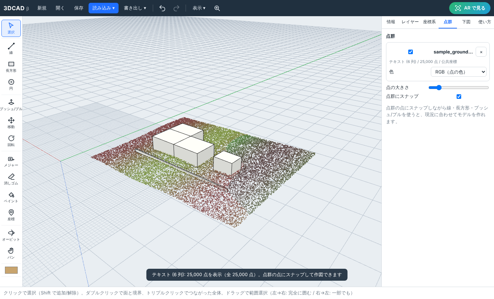

# 3DCAD

SketchUp のような感覚的な操作で、**発注図面（2D）から 3D モデルを作り、点群と重ね、公共座標で管理し、AR で確認できる** ブラウザ 3D CAD です。

インストール不要で、PC のブラウザ（Chrome / Edge / Safari）とタブレット・スマホで動きます。



## できること

| 分類 | 内容 |
| --- | --- |
| **SketchUp 風の操作** | 線・長方形・円・プッシュ/プル・移動（Ctrl でコピー、`5x` で配列）・回転・メジャー・消しゴム・ペイント。端点・中点・エッジ上・面上・軸方向の**推定（スナップ）**、矢印キーで方向ロック、数字を打つだけの寸法入力、線で囲むと自動で面ができる、面上に線を引くと面が分割される |
| **穴・開口** | 面の内側に長方形・円を描くと面に刻み込まれ、押し込むと凹み、反対側の面まで押し込むと貫通して開口（窓・ダクト穴など）になる。引き出すと出っ張り |
| **グループ** | Ctrl+G でグループ化すると他の物とくっつかない。まとめて移動・コピー（コピーは別グループ）、ダブルクリックで中を編集（外側は薄く表示、Esc で終了）、Ctrl+Shift+G で解除 |
| **発注図面 → 3D** | DXF（Shift_JIS / UTF-8、ブロック・ポリライン・円弧に対応）と SXF の SFC を読み込み、画層ごとに閉じた領域へ自動で面を張り、**レイヤー単位で一括押し出し**。PDF・画像は下図として敷いて、2 点の寸法で縮尺を合わせてなぞれる |
| **公共座標** | 平面直角座標系 第 1〜19 系（JGD2011）。プロジェクト原点を公共座標上に置き、カーソル位置を X・Y・H で常時表示。緯度経度との相互変換（PROJ と 1mm 以内で一致することをテストで確認）。既知点をクリックして座標を入力すると位置合わせできる |
| **点群との親和性** | LAS（1.0〜1.4, 非圧縮）・PLY・XYZ / TXT / CSV / PTS を公共座標のまま読み込み、モデルと重ねて表示。**点群の点にスナップして作図**できる。RGB / 標高 / 反射強度で色分け |
| **AR** | 「AR で見る」ボタンで、iPhone / iPad は AR Quick Look（USDZ を自動生成）、Android は WebXR（床を検出してタップで配置、縮尺 1:1〜1:500・回転） |
| **書き出し** | GLB（公共座標の基準点つき）・USDZ・OBJ（公共座標 / ローカル）・DXF 3D（公共座標 / ローカル） |
| **保存** | プロジェクトファイル（`.3dcad.json`）とブラウザ内の自動保存 |

## 使い方

すぐ試すには「読み込み → サンプル（配置図＋点群）を開く」を選んでください。

```bash
npm install
npm run dev        # http://localhost:5173 （同じ LAN のスマホからも開けます）
npm run build      # dist/ に静的ファイルを出力（どの Web サーバーにも置けます）
npm test           # 単体テスト
```

> **AR を Android で使うには HTTPS が必要です。** `dist/` を HTTPS のサーバー（GitHub Pages など）に置いて開いてください。iPhone の AR Quick Look は HTTP でも動きます。

### 発注図面から 3D を作る流れ

1. 「座標系」パネルで平面直角座標の **系番号** を選ぶ
2. 「読み込み → 発注図面」で DXF / SFC を開く（ファイルのドラッグ＆ドロップでも可）
   - 単位（mm / m）と座標（公共座標 / ローカル）を選ぶ。公共座標の図面なら、点群と自動で位置が合います
   - 外形線・構造物の画層に「面」のチェックを入れる（寸法線・文字・ハッチングは外す）
3. 「レイヤー」パネルの **押し出し** で高さを入れると、その画層の面がまとめて立体になる
4. 細部はプッシュ/プル（P）で面を引っ張って調整。窓や段差は面の上に線を引いて分割してから押し引きする
5. 「AR で見る」で確認

PDF しかない場合は「読み込み → 下図」で敷き、「下図」パネルの **縮尺合わせ（2 点）** で寸法の分かる 2 点を指定してから、線（L）・長方形（R）でなぞります。

`samples/` に試せるデータがあります。

- `sample_plan_jgd2011_9kei.dxf` … 公共座標（第 9 系, m）の配置図（建物外形・擁壁・寸法線・文字の画層）
- `sample_ground_jgd2011_9kei.xyz` … 同じ場所の地盤の点群（x=東, y=北, z=標高, RGB）

DXF を「公共座標」「高さ 12m」で読み込み、「建物外形」を 6000 で押し出してから点群を読み込むと、点群の上に建物が並びます。

### 操作（SketchUp と同じキー）

| 操作 | キー / マウス |
| --- | --- |
| 視点の回転 / パン / ズーム | 中ボタン / Shift+中・右ボタン / ホイール（トラックパッドは O・H ツール） |
| 選択・線・長方形・円 | Space・L・R・C |
| プッシュ/プル・移動・回転 | P・M（Ctrl でコピー）・Q |
| メジャー・座標・消しゴム・ペイント | T・I・E・B |
| 方向ロック | → 赤（東西）/ ← 緑（南北）/ ↑ 青（高さ）、作図中の Shift |
| 寸法の入力 | そのまま数字を打って Enter（単位 mm。`1.5m`、長方形は `3000,2000`、円の分割数は `36s`） |
| グループ化・解除・中を編集 | Ctrl+G・Ctrl+Shift+G・ダブルクリック（Esc で終了） |
| 全体表示・元に戻す・やり直し | Shift+Z・Ctrl+Z・Ctrl+Y |

## 座標の扱い

- 内部の 3D 座標は Three.js の慣例（Y が上）で、**+X = 東、+Y = 上、−Z = 北**。画面の赤い軸 = 東、緑の軸 = 北、青の軸 = 上です。
- 公共座標は測量の慣例で **X = 北、Y = 東、H = 標高**。数万 m の値をそのまま GPU に送ると精度が落ちるため、「プロジェクト原点」からの相対座標で描画し、座標の計算は倍精度で行います。
- 公共座標の DXF・点群を最初に読み込んだとき、原点が未設定ならその近く（100m 単位）に自動で設定します。
- 点群ファイルの列の並びは「x=東, y=北（LAS・GIS 標準）」と「x=北, y=東（測量の XY 順）」を選べます。
- GLB にはモデル原点の公共座標・系番号・緯度経度を `extras.georeference` として埋め込みます。OBJ / DXF は公共座標（x=Y東, y=X北, z=H）のまま書き出せるので、CloudCompare などの点群ソフトや他の CAD とそのまま重ねられます。

### 他の点群ソフト（点群スコープなど）との連携

- 点群は LAS / PLY / XYZ・CSV・PTS で、同じ平面直角座標系のまま受け渡しできます。
- 作ったモデルは OBJ / DXF（公共座標）で書き出すと、点群ソフト側で同じ位置に重なります。
- 専用の形式やデータ連携が必要であれば、`src/io/pointcloud.ts` に読み込み処理を追加するだけで対応できる構成になっています。

## ソースの構成

```
src/
  core/      Model（頂点・エッジ・面、プッシュ/プル、面の自動生成・分割）, History, Selection, units
  geo/       平面直角座標系 ⇔ 緯度経度（Krüger 級数 5 次）, GeoReference（プロジェクト原点）
  view/      Viewport, ModelRenderer, Inference（推定・スナップ）, Overlay, PointCloudManager, UnderlayManager
  tools/     選択・線・長方形・円・プッシュ/プル・移動・回転・メジャー・消しゴム・ペイント・座標・下図調整
  io/        DXF・SXF(SFC)・図面→モデル変換（交点分割と閉領域検出）・点群（LAS/PLY/XYZ）・書き出し・プロジェクト
  ar/        AR Quick Look（iOS）と WebXR（Android）
  ui/        ツールバー・パネル・ダイアログ
tests/       単体テスト（Vitest）
samples/     試用データ
```

## 現在の制限と今後の予定

- 面の縁に接する（はみ出す）図形の刻み込みと、立体どうしのブーリアン演算は未対応（刻み込みは面の内側に収まる図形のみ）
- グループの入れ子、コンポーネント（同じ部品の一括編集）、円弧ツール、オフセット、フォローミー、寸法・文字の配置は今後追加予定
- SXF は SFC 形式の基本図形のみ（複合図形の縮尺・P21 形式は未対応 → CAD で DXF に変換してください）。JWW・DWG も DXF に変換してから読み込みます
- LAZ（圧縮 LAS）は未対応（LAS に変換してください）。数百万点を超える点群は間引いて表示します
- AR は「床に置いて見る」方式です。GNSS とコンパスを使って現地の公共座標の位置にそのまま重ねる「位置合わせ AR」は今後の課題です
